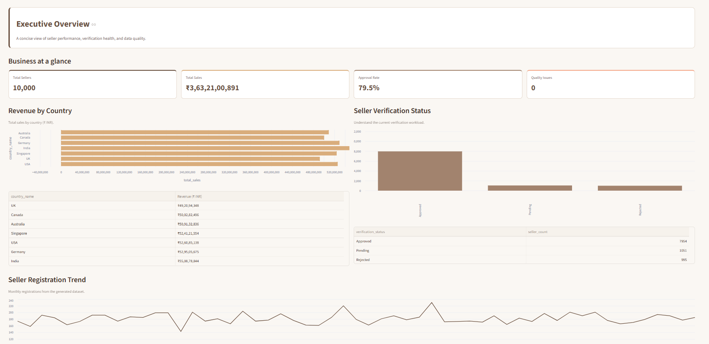
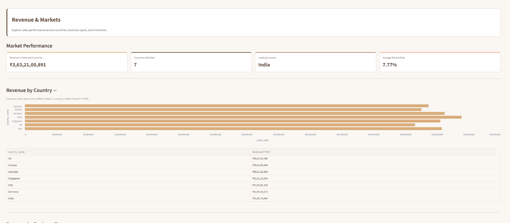
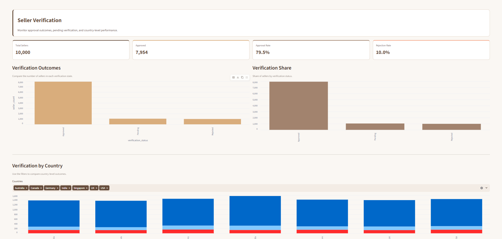
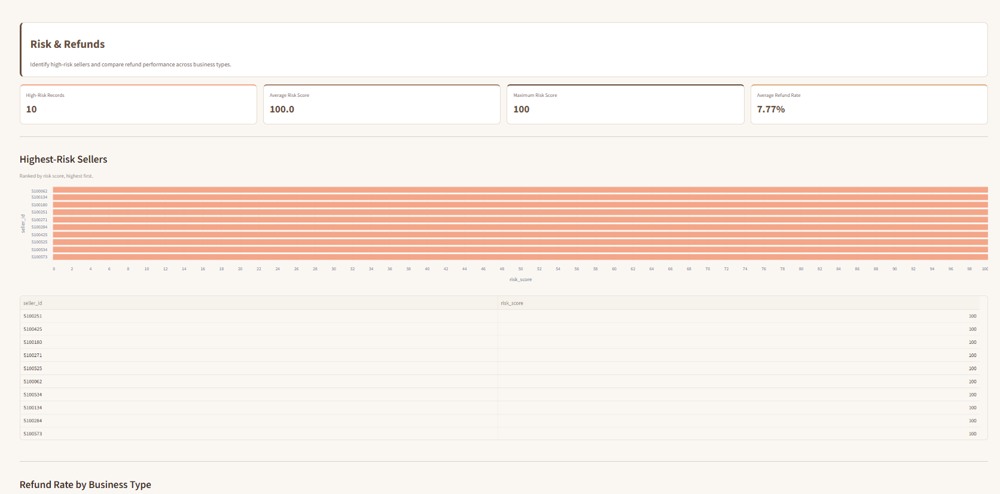
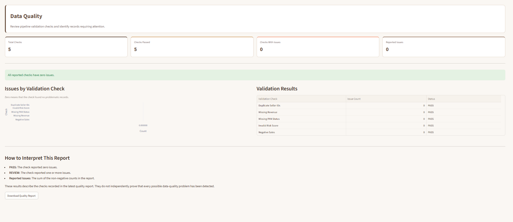
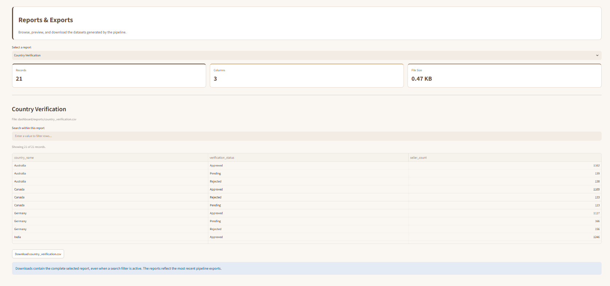

# Seller Verification Data Engineering Platform

An end-to-end data engineering project that simulates seller onboarding and verification for an e-commerce platform. It demonstrates synthetic data generation, ETL processing, a Bronze–Silver–Gold architecture, dimensional data warehousing, automated data quality checks, SQL analytics, and an interactive Streamlit dashboard.

**Built with:** Python · Pandas · DuckDB · Parquet · SQL · Streamlit · Pytest

---

## Table of Contents

- [Project Overview](#project-overview)
- [Key Features](#key-features)
- [Dashboard Preview](#dashboard-preview)
- [Architecture](#architecture)
- [Technology Stack](#technology-stack)
- [Data Warehouse Design](#data-warehouse-design)
- [Key Results](#key-results)
- [Project Structure](#project-structure)
- [Getting Started](#getting-started)
- [Running Tests](#running-tests)
- [Analytics Exports](#analytics-exports)
- [Example Business Questions](#example-business-questions)
- [Limitations and Future Improvements](#limitations-and-future-improvements)

---

## Project Overview

E-commerce platforms need reliable processes to validate sellers, organize operational data, monitor business performance, and identify potentially high-risk accounts.

This project implements a reproducible data pipeline using **10,000 synthetic seller profiles**. Raw datasets are ingested, cleaned, validated, transformed into a dimensional warehouse, and analyzed through SQL queries. The resulting datasets power an interactive dashboard for exploring revenue, verification status, registration trends, refunds, risk scores, and data quality.

The project focuses on demonstrating practical data engineering concepts rather than making real-world fraud predictions.

## Key Features

- Synthetic seller and operational data generation using Faker.
- Modular, six-stage ETL pipeline.
- Bronze–Silver–Gold data architecture using CSV and Parquet.
- Data cleaning, validation, and duplicate handling.
- DuckDB analytical warehouse with fact and dimension tables.
- SQL-based business intelligence and risk analytics.
- Automated data quality checks.
- Interactive, multipage Streamlit dashboard.
- Exportable CSV reports for further analysis in Excel or Power BI.
- Automated test suite using Pytest.

## Dashboard Preview

### Executive Overview



### Revenue and Markets



### Seller Verification



### Risk and Refunds



### Registration Trends

The registration trends page is available in the dashboard. A dedicated screenshot can be added here when captured.

### Data Quality



### Reports and Exports



## Architecture

The project follows a layered data engineering architecture.

```text
Synthetic Data Generation
          |
          v
     Raw CSV Data
          |
          v
   BRONZE - Ingestion
   Raw data stored as Parquet
          |
          v
    SILVER - Cleaning
   Cleaned and validated data
          |
          v
     GOLD - Warehouse
   DuckDB dimensional model
          |
          v
      SQL Analytics
          |
          +-------------------+
          |                   |
          v                   v
   CSV Report Exports   Streamlit Dashboard
                              |
                              v
                    Business Insights
```

### Pipeline Stages

1. **Data Generation:** Creates synthetic seller and operational datasets.
2. **Bronze Ingestion:** Ingests raw CSV datasets and stores them as Parquet.
3. **Silver Cleaning:** Applies data cleaning and validation transformations.
4. **Gold Warehouse:** Builds a DuckDB dimensional warehouse.
5. **Data Quality:** Executes validation checks and generates a quality report.
6. **SQL Analytics:** Runs analytical queries and exports results as CSV files.

The pipeline is orchestrated through `app/run_pipeline.py`. Each stage is executed as a separate Python module, with execution status, duration, and failures logged.

## Technology Stack

| Category | Technologies |
|---|---|
| Programming Language | Python |
| Data Processing | Pandas |
| Synthetic Data | Faker |
| Data Storage | CSV, Apache Parquet |
| Data Warehouse | DuckDB |
| Query Language | SQL |
| Dashboard | Streamlit |
| Testing | Pytest |
| Data Interchange | CSV exports |
| Version Control | Git, GitHub |

## Data Warehouse Design

The Gold layer uses a dimensional model to support analytical queries.

### Fact Table

- `fact_seller`

Contains seller-level records and measurable business attributes used for reporting and analysis.

### Dimension Tables

- `dim_country`
- `dim_business`
- `dim_date`
- `dim_verification`
- `dim_risk`

These dimensions organize seller information by geography, business type, date, verification status, and risk classification.

The warehouse is stored at:

```text
data/gold/warehouse.duckdb
```

## Key Results

The current synthetic dataset and analytics produce the following results:

| Metric | Result |
|---|---:|
| Seller Profiles | 10,000 |
| Average Risk Score | 50.66 |
| Maximum Risk Score | 100 |
| Very High-Risk Sellers | 2,008 |
| Average Refund Rate Across Business Types | 7.77% |
| Automated Tests Passing | 24 |

**Risk classification:** The current analytics classify sellers with a risk score of 81 or above as very high risk.

**Data quality:** Five automated quality checks are included in the quality report. The current generated dataset has passed these checks with zero reported issues.

These results are derived from synthetic data and demonstrate the pipeline's analytical capabilities. They are not evidence of real-world fraud detection accuracy.

## Project Structure

```text
seller-verification-data-engineering-platform/
├── .github/
│   └── workflows/
├── .streamlit/
├── app/
│   ├── analytics.py
│   ├── clean.py
│   ├── config.py
│   ├── data_generator.py
│   ├── ingest.py
│   ├── logger.py
│   ├── quality.py
│   ├── run_pipeline.py
│   └── warehouse.py
├── dashboard/
│   ├── app.py
│   ├── common.py
│   ├── pages/
│   └── exports/
├── data/
│   ├── bronze/
│   ├── silver/
│   └── gold/
├── docs/
│   └── screenshots/
├── logs/
├── sql/
│   ├── analytics.sql
│   ├── ddl.sql
│   ├── dimensions.sql
│   ├── facts.sql
│   ├── schema.sql
│   └── validation.sql
├── tests/
├── requirements.txt
├── README.md
└── .gitignore
```

## Getting Started

### Prerequisites

- Python 3.14, matching the current development environment.
- Git.
- Windows PowerShell or an equivalent terminal.

### 1. Clone the repository

```powershell
git clone https://github.com/akshithramineni-2006/seller-verification-data-engineering-platform.git
cd seller-verification-data-engineering-platform
```

### 2. Create a virtual environment

```powershell
python -m venv venv
```

Activate it in PowerShell:

```powershell
.\venv\Scripts\Activate.ps1
```

### 3. Install dependencies

```powershell
python -m pip install --upgrade pip
pip install -r requirements.txt
```

### 4. Run the complete pipeline

From the project root, execute:

```powershell
python -m app.run_pipeline
```

The pipeline runs data generation, Bronze ingestion, Silver cleaning, warehouse construction, data quality validation, and SQL analytics in sequence.

### 5. Launch the dashboard

After the pipeline completes successfully, run:

```powershell
python -m streamlit run dashboard/app.py
```

Streamlit will display a local URL in the terminal. Open that URL in your browser to explore the dashboard.

## Running Tests

Run the automated test suite from the project root:

```powershell
python -m pytest -q
```

**Latest verified result:** 24 tests passed.

Run the tests again after modifying the pipeline, warehouse, SQL analytics, or dashboard-supporting logic.

## Analytics Exports

Analytical CSV files are generated in:

```text
dashboard/exports/
```

The exports support further analysis in Excel, Power BI, or other tools that accept CSV files.

Available report categories include:

- Total seller counts.
- Revenue by country.
- Revenue by business type.
- Monthly seller registrations.
- Industry revenue.
- Refund-rate analysis.
- High-risk seller records.
- Risk-score distribution.
- Overall risk metrics.
- Data quality results.

## Example Business Questions

The warehouse and dashboard support questions such as:

- Which countries generate the highest seller revenue?
- Which business types contribute the most revenue?
- How do seller registrations change over time?
- How are sellers distributed across risk-score bands?
- Which sellers have the highest risk scores?
- Which business types report higher refund rates?
- Are the current datasets passing the configured data quality checks?

## Limitations and Future Improvements

The current project uses synthetic data and a locally stored DuckDB warehouse. Potential future enhancements include:

- Apache Airflow for workflow orchestration.
- AWS S3 for cloud-based data storage.
- Apache Kafka for event streaming.
- Apache Spark for distributed processing.
- Docker for reproducible deployment.
- Expanded CI/CD and data quality monitoring.
- Integration with real, appropriately authorized datasets.

These are potential extensions and should not be interpreted as features already implemented in the current pipeline.

---

## Author

**Akshith Ramineni**
B.Tech, Computer Science and Engineering (Data Science)
Manipal Institute of Technology, Bengaluru

[GitHub Repository](https://github.com/akshithramineni-2006/seller-verification-data-engineering-platform)
